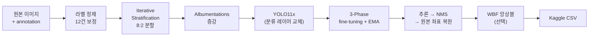

# 💊 PillDetect — 경구약제 이미지 객체 탐지

알약 사진 한 장에서 **최대 4개 알약의 종류(56종)와 위치(bounding box)**를 찾는 객체 탐지 모델입니다.
코드잇 AI 엔지니어 부트캠프 11기 초급 프로젝트로, 4명이 팀으로 진행했습니다 (2026.05 – 06).

> 이 저장소는 팀 저장소 [beomjin2/PillDetect](https://github.com/beomjin2/PillDetect)를 포트폴리오용으로 옮긴 것입니다.
> 팀 공동 작업물이며, 제가 맡은 부분은 [내 역할](#내-역할--박창준-후처리--실험)에 따로 정리했습니다.

| | |
|---|---|
| **최종 점수** | Kaggle mAP **0.956** (9개 모델 WBF 앙상블) |
| **단일 모델 최고** | 0.949 (YOLO11x · 1024px · 200 epoch) |
| **출발점** | 0.173 (YOLOv8n baseline) |
| **데이터** | 학습 이미지 232장 · 박스 763개 · 56개 클래스 / 테스트 이미지 842장 |
| **제출 횟수** | 22회 |
| **발표 자료** | [최종 발표 슬라이드](https://cjkj1234.github.io/beginner-project-pill/slides/health-eat-final.html) · [W&B 실험 리포트](https://cjkj1234.github.io/beginner-project-pill/slides/health-eat-wandb-report.html) |

---

## 문제와 어려움

- 데이터가 적고 불균형합니다. 가장 많은 클래스는 153번, 가장 적은 클래스는 3번 나옵니다.
- 색과 모양이 비슷한 알약이 많아서, 표면에 새겨진 각인이 사실상 유일한 구분 단서입니다.
- 테스트 이미지에는 알약이 최대 4개뿐이라, 학습 장면도 이 조건에 맞춰야 했습니다.
- 라벨에도 오류가 있었습니다. 좌표 오기입 1건, 중복 박스 3건, 라벨 누락 8건을 찾아 보정했습니다 ([`configs/bbox_corrections.json`](configs/bbox_corrections.json)).

## 접근 방법



**학습 루프를 직접 구현했습니다.** Ultralytics의 `YOLO.train()`은 학습 과정을 감춰서, 에폭마다 어떤 레이어를 학습할지 조절할 수 없습니다.
그래서 Ultralytics에서는 사전학습 가중치, 손실 함수(`v8DetectionLoss`), NMS 세 가지만 가져오고 나머지는 직접 만들었습니다.

| 기법 | 내용 | 효과 |
|---|---|---|
| 3-Phase fine-tuning | ① 새 분류 레이어만 → ② Detect head 전체 → ③ 전체 (backbone LR은 head의 1/10) | 사전학습 특징을 지키면서 안정적으로 수렴 |
| EMA | 가중치의 지수 이동 평균으로 추론 | 같은 버전 기준 0.722 → 0.916 (+0.194, 단일 최대 개선) |
| Mosaic 제거 | 4장을 합치는 증강이 "최대 4개" 테스트 조건과 맞지 않음 | 0.540 → 0.699 |
| Iterative Stratification | 이미지당 여러 클래스가 있어 다중 라벨 기준으로 분할 | 희귀 클래스가 val에서 빠지지 않음 |
| WeightedRandomSampler | 희귀 클래스가 든 이미지를 배치에 더 자주 넣음 | 클래스 불균형 완화 |
| WBF 앙상블 | 여러 모델의 박스를 버리지 않고 가중 평균, 클래스는 확률 평균으로 재투표 | YOLOv8l 단일(0.929) 대비 +0.027 |

## 실험 기록

| 버전 | 모델 | 핵심 변경 | Kaggle |
|---|---|---|---|
| v1 | YOLOv8n | baseline | 0.173 |
| v2.1 | YOLOv8n | 3-Phase 학습 + Mosaic ON | 0.540 |
| v2.2 | YOLOv8n | Mosaic OFF | 0.699 |
| v2.5 | YOLOv8s | EMA + 200 epoch | 0.916 |
| v2.7 | YOLOv8l | 모델 스케일업 | 0.929 |
| **WBF-v1** | YOLOv8l ×8 + YOLOv8x | 9개 모델 WBF 앙상블 | **0.956** |
| Q3 | YOLO11x | 같은 조건에서 YOLOv8x(0.917)와 비교 | 0.938 |
| Q4 | YOLO11x | epoch 탐색 (250이 최적, 700은 과적합 0.936) | 0.943 |
| **Q5-B** | YOLO11x | 1024px 고해상도 | **0.949** |

**효과가 없었던 실험**도 기록했습니다.

- **GrabCut 합성 데이터 3,000장:** 0.943 → 0.936으로 떨어졌습니다. 잘라 붙인 알약의 경계와 조명이 어색해서 오히려 노이즈가 됐습니다.
- **1280px · batch 4:** val mAP가 계속 떨어져 조기 종료했습니다.
- **WBF 파라미터 조정:** 0.956 → 0.955로, 효과가 없었습니다. 앙상블 성능은 파라미터보다 입력 모델의 품질에 달려 있었습니다.

## 내 역할 — 박창준 (후처리 · 실험)

모델 출력을 제출 파일로 바꾸는 **추론·후처리·제출 파이프라인**을 맡았습니다.

**직접 만든 코드**
- [`src/engine/postprocess.py`](src/engine/postprocess.py) — 모델 원시 출력 `[B, 4+클래스 수, 앵커 수]`에 NMS를 적용해 박스·점수·클래스로 정리하고, 앙상블용 클래스 확률(`class_probs`)도 뽑습니다 ([#37](https://github.com/beomjin2/PillDetect/pull/37), [#88](https://github.com/beomjin2/PillDetect/pull/88))
- [`src/engine/predict.py`](src/engine/predict.py) — 배치 단위 추론 ([#26](https://github.com/beomjin2/PillDetect/pull/26))
- [`src/submission/make_submission.py`](src/submission/make_submission.py) — 내부 좌표(xyxy)를 Kaggle 형식(xywh)으로 바꿔 CSV를 만듭니다 ([#40](https://github.com/beomjin2/PillDetect/pull/40))
- 테스트 3종 — [`test_postprocess.py`](tests/test_postprocess.py), [`test_make_submission.py`](tests/test_make_submission.py), [`test_inference_submission_pipeline.py`](tests/test_inference_submission_pipeline.py) ([#64](https://github.com/beomjin2/PillDetect/pull/64) 등)
- `uv.lock` 파싱 오류 수정 ([#44](https://github.com/beomjin2/PillDetect/pull/44))

**실험·분석**
- 후처리에 Ultralytics NMS를 적용해, 팀 전체가 모델 예측을 같은 기준으로 비교할 수 있게 통일했습니다 ([#88](https://github.com/beomjin2/PillDetect/pull/88))
- 후처리 조건 실험: class-agnostic NMS, 박스 좌표 clamp, 너무 큰 박스 제거 ([#76](https://github.com/beomjin2/PillDetect/pull/76)). 이 중 class-agnostic NMS는 최종 설정(`class_agnostic_nms: true`)에도 쓰였습니다.
- 하이퍼파라미터 튜닝, 실험 로그 관리, TTA·WBF 앙상블 실험을 맡았습니다 ([#55](https://github.com/beomjin2/PillDetect/issues/55), [#56](https://github.com/beomjin2/PillDetect/issues/56), [#58](https://github.com/beomjin2/PillDetect/issues/58), [#59](https://github.com/beomjin2/PillDetect/issues/59))
- 협업 일지: [박창준(Exp)](https://beomjin2.github.io/Sprint_First_Proj/%ED%98%91%EC%97%85%EC%9D%BC%EC%A7%80/%EB%B0%95%EC%B0%BD%EC%A4%80(Exp)/)

## 배운 점

- **증강은 많을수록 좋은 게 아닙니다.** 테스트 환경과 다른 장면을 만드는 증강(Mosaic)은 점수를 떨어뜨렸습니다.
- **검증 점수가 포화되면 리더보드가 유일한 신호입니다.** 200 epoch 이후 val mAP@50이 1.0에 붙어서, 과적합은 Kaggle 점수로만 알 수 있었습니다.
- **합성 데이터는 양보다 품질입니다.** 3,000장을 더했지만 경계 아티팩트 때문에 점수가 내려갔습니다.
- **학습 안정화가 모델 키우기보다 효과가 컸습니다.** EMA 하나로 +0.194를 얻었고, YOLOv8l → YOLO11x 교체는 +0.01 안팎이었습니다.

---

## 저장소 구조

```
├── train.py                  # 학습 진입점 (3-Phase, EMA, W&B 로깅)
├── predict.py                # 추론 → predictions.json + submission.csv
├── ensemble_wbf.py           # 여러 predictions.json을 WBF로 합쳐 제출 파일 생성
├── configs/
│   ├── default.yaml          # 팀 저장소 마지막 설정 (1280px 실험, 미제출)
│   ├── yolo11x_1024.yaml     # 단일 모델 최고점 설정 (Q5-B, 0.949)
│   ├── class_mapping.json    # Kaggle category_id ↔ 학습용 class_id (56종)
│   └── bbox_corrections.json # 라벨 보정 12건
├── src/
│   ├── data/                 # Dataset, 분할, 증강, Mosaic, 합성 데이터 Dataset
│   ├── models/baseline.py    # YOLO 로드 + 분류 레이어 교체 + freeze/unfreeze
│   ├── engine/               # 학습 1 epoch, EMA, 평가(mAP·F1), 추론, 후처리, 체크포인트
│   ├── submission/           # Kaggle CSV 생성
│   └── utils/                # 설정 로더, bbox 변환, 시드, 클래스 가중치
├── scripts/                  # GrabCut 합성 데이터 생성, W&B 유틸
├── notebooks/                # 데이터 구조·EDA, Colab 학습·제출, 앙상블 제출
├── tests/                    # pytest (GitHub Actions에서 자동 실행)
└── slides/                   # 발표 자료 (GitHub Pages로 배포)
```

## 실행 방법

**환경 준비** — Python 3.14, [uv](https://docs.astral.sh/uv/)

```bash
uv sync
```

**데이터** — 부트캠프 내부 Kaggle 대회 데이터라 저장소에 포함하지 않았습니다. 아래 위치에 두면 됩니다.

```
data/raw/ai11-level1-project/sprint_ai_project1_data/
├── train_images/        # *.png
├── train_annotations/   # COCO 형식 *.json
└── test_images/         # *.png
```

> AI Hub `경구약제조합 5000종`의 `TL_2_조합.zip`, `TS_2_조합.zip`은 Kaggle 테스트셋 기반이라 학습에 쓰지 않았습니다.

**학습**

```bash
uv run python train.py --config configs/yolo11x_1024.yaml --run-name q5b-1024
```

- GPU가 없으면 `--num_workers 0`을 붙입니다.
- `WANDB_API_KEY` 환경 변수가 없으면 W&B 로깅은 자동으로 꺼지고, 지표는 `outputs/logs/`에 CSV로 남습니다.
- 가장 좋은 체크포인트는 `outputs/checkpoints/best_model.pt`에 저장됩니다 (`--version v1`을 주면 `best-v1.pt`).

**예측 · 제출 파일 생성**

```bash
uv run python predict.py --config configs/yolo11x_1024.yaml --checkpoint outputs/checkpoints/best_model.pt --use-ema
```

결과는 `outputs/predictions/predictions.json`과 `outputs/submissions/submission_v1.csv`에 저장됩니다.

**WBF 앙상블** — 모델마다 만든 `predictions.json`을 합칩니다. 성능이 좋은 모델에 큰 가중치를 줍니다.

```bash
uv run python ensemble_wbf.py --preds pred_a.json pred_b.json --weights 2 1 --output outputs/submissions/submission_wbf.csv
```

**테스트**

```bash
uv run pytest tests/
```

## 기술 스택

PyTorch · Ultralytics (YOLOv8 / YOLO11) · Albumentations · OpenCV · torchmetrics · ensemble-boxes · Weights & Biases · uv · pytest · GitHub Actions

## 팀

| 이름 | 역할 | GitHub |
|---|---|---|
| 김범진 | PM · 학습 엔진 (3-Phase 학습 루프, BN 버그 수정, Mosaic 제거, 협업 자동화) | [@beomjin2](https://github.com/beomjin2) |
| 유재열 | Model (모델 초기화·분류 레이어 교체, EMA 구현) | [@YuJY9897](https://github.com/YuJY9897) |
| 황원재 | Data (EDA, Dataset 클래스, 클래스 매핑, train/val 분할) | [@zipdid](https://github.com/zipdid) |
| 박창준 | Exp · 후처리 (추론, NMS, 제출, 실험 관리) | [@cjkj1234](https://github.com/cjkj1234) |

- 팀 원본 저장소: [beomjin2/PillDetect](https://github.com/beomjin2/PillDetect)
- 팀 협업 일지 (Quartz): [beomjin2.github.io/Sprint_First_Proj](https://beomjin2.github.io/Sprint_First_Proj/)
- W&B 프로젝트: [health-eat-pill-detection](https://wandb.ai/health-eat-pill-detection/health-eat-pill-detection)

## 팀 저장소 이후 바꾼 점

포트폴리오로 옮기면서 아래를 고쳤습니다. 학습 로직과 실험 결과는 바꾸지 않았습니다.

- `wandb`, `tqdm`을 의존성에 추가했습니다 (`uv sync` 후 `train.py`가 ImportError로 멈추던 문제).
- `--num_workers 0`(CPU 실행)에서 DataLoader가 에러를 내던 문제를 고쳤습니다.
- `train.py`, `predict.py`, `ensemble_wbf.py`에 `if __name__ == "__main__":`을 추가했습니다. Windows·macOS에서 DataLoader 워커가 학습을 다시 실행하던 문제입니다.
- `--config`로 다른 설정을 넘겨도 모델 이름은 늘 `default.yaml`에서 읽던 문제를 고쳤습니다.
- 단일 모델 최고점 설정을 [`configs/yolo11x_1024.yaml`](configs/yolo11x_1024.yaml)로 복원했습니다 (팀 저장소 커밋 `12c823f` 기준).
- 팀 전용 GitHub Actions(Discord 알림, Obsidian 동기화)를 지우고 pytest CI만 남겼습니다.
